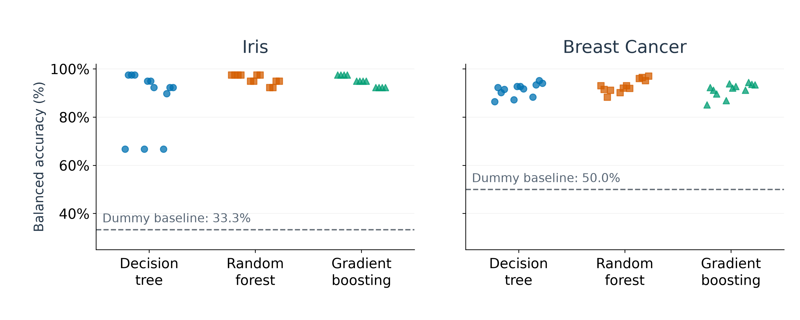
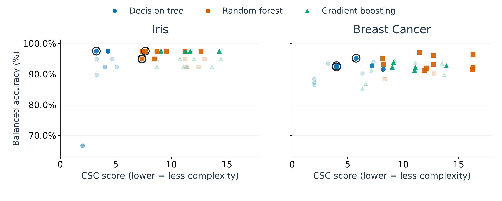

# CSC: developing and evaluating a tree-model complexity metric

This project develops Cognitive-Structural Complexity (CSC), then evaluates it on decision trees, random forests and gradient boosting trained on Iris and Wisconsin Diagnostic Breast Cancer. Predictive performance is checked first. Complexity is then compared among competitive models.

## Start here

- [Five-minute submission presentation](presentation/presentation.pdf)
- [Long explanatory presentation](presentation/presentation_long.pdf)
- [Threshold investigation](results/threshold_v1/report.md)
- [Dataset meta-feature study](results/metafeatures_v1/report.md)
- [Speaker notes](presentation/speaker_notes.md)
- [Full real-data report](results/metric_development_v2/report.md)
- [Locked protocol](protocols/metric_development_v2.md)
- [Definitions and source attribution](docs/metric_development_sources.md)

The submission deck has seven slides targeting 300 seconds. The long deck retains the formula-development story and adds the threshold and dataset-property findings. Both have speaker notes; rehearse to confirm delivery time.

## How the metric developed

1. **Expected Path Length (EPL):** mean internal decisions visited in one tree, weighted by reference-example occupancy.
2. **Expected Ensemble Path Complexity (EEPC):** sum the tree EPL values for total visits; divide by the actual number of prediction trees for the per-tree mean.
3. **Ensemble-adjusted complexity (EA):** multiply that mean path length by a logarithmic used-feature burden. This recognizes inputs used, but does not distinguish multiple thresholds on the same feature.
4. **MDL motivation:** consider how much structure needs describing. Formal MDL uses specified codes; CSC borrows this motivation without computing a genuine code length.
5. **CSC:** retain mean path length and add logarithmic distinct-rule and distinct-tree terms.

```text
EPL(T)     = mean internal decisions visited in tree T
EEPC_total = sum of individual tree EPL values
EEPC_mean  = EEPC_total / actual prediction-tree count
EA         = EEPC_mean * log2(1 + features used)
CSC        = EEPC_mean + log2(1 + distinct split tests) + log2(distinct full trees)
```

EA_total, based on total rather than mean paths, is saved as a separate sensitivity. A bare EPL field is populated only for single trees; ensembles have per-tree EPL lists and explicit total/mean columns. These conventions were fixed before the revised run. Used features are distinct split feature positions, not all dataset columns. Tree count includes class-specific trees in multiclass boosting.

CSC remains version 1.0. Split identities retain exact thresholds and routing; full-tree identities retain topology, outputs and channels. Its equal weights and logarithms are assumptions. A lower score is not proven easier for people to understand. The development is a sequence of proposals, not a formal derivation from MDL or a claim of demonstrated superiority.

## Evaluate prediction quality first

The original 12-configuration grid and seeds 42/1337/2026 are preserved. All configurations within a dataset/seed share stratified approximately 50% training, 25% validation and 25% test partitions. No learned preprocessing is needed for this numeric pipeline.

A `DummyClassifier(strategy="prior")` is trained on each training partition. A model enters the primary complexity comparison only when its validation balanced accuracy:

- strictly exceeds the dummy baseline; and
- is within 2 percentage points of the best candidate in that dataset/seed.

Balanced accuracy is average recall across classes. “Competitive” is a benchmark criterion, not a universal application threshold. All 72 candidates beat the dummy baseline; 35 also meet the near-best criterion (15 Iris, 20 Breast Cancer).



## Apply and evaluate CSC

Among competitive candidates, choose minimum validation CSC, breaking ties by model ID. An accuracy-only selector chooses maximum validation balanced accuracy, with the same deterministic model-ID tie-break. Both choices are frozen before test scoring and are not refitted. Coincident choices reuse a single test evaluation.



| Dataset | Selection | Mean test balanced accuracy | Mean test CSC |
|---|---|---:|---:|
| Iris | Accuracy-only | 96.44% | 6.10 |
| Iris | Minimum CSC | 96.44% | 6.10 |
| Breast Cancer | Accuracy-only | 94.39% | 11.12 |
| Breast Cancer | Minimum CSC | 92.45% | 4.59 |

Iris selects the same models under both rules. Breast Cancer trades some predictive performance for lower measured complexity. These are descriptive means across three overlapping splits; individual rows and sample SDs are in the report. Test data were already inspected in prior work, so this is follow-up rather than independent confirmation.

Within-group rankings show strong agreement between CSC and node count. EA differs more in groups with several competitive models. Differences in ranking do not establish which metric is better for people. The two Iris groups with only two competitive models provide especially weak evidence about ranking agreement.

## Reproduce

From this project directory:

```powershell
uv sync --extra dev
uv run pytest
uv run python scripts/run_metric_development.py
uv run python scripts/plot_metric_development.py
```

These scripts take no arguments. They write only to `results/metric_development_v2/`, reconstruct fits from the locked original setup, reconcile all 78 original result rows, and preserve original `results/scores.csv` and `results/summary.json`. New tables contain 72 validation candidates, 6 dummy baselines, 12 selector decisions and 9 distinct selected test evaluations. Split IDs, dataset hashes, environment versions, source hashes and reconciliation errors are saved.

Do not run `scripts/run_experiment.py` to reproduce v2: it remains the original baseline entry point and would overwrite the old results. No controlled-study script is part of the v2 workflow.

### Rebuild the presentation

Generate v2 and the remaining-task tables and figures first. The slide builder uses Node.js and `@oai/artifact-tool`, supplied by the desktop runtime or an existing installation. If the module is outside Node's search path, set `CSC_ARTIFACT_MODULE` to the absolute `artifact_tool.mjs` path returned by the desktop runtime's workspace-dependencies tool.

```powershell
node scripts/build_presentation.mjs
python scripts/build_pdf.py --manifest slide_manifest_long.json --output presentation_long.pdf
node scripts/build_submission_presentation.mjs
python scripts/build_pdf.py
```

The second command needs reportlab in that Python environment. The bundled desktop Python includes it; reportlab is not part of the project's modeling dependency extra. The slide builder writes a manifest, notes and high-resolution previews. PDF packaging uses exactly the manifest-listed slides, excluding stale images. The supplied PDF contains rendered pages; chart PDFs/SVGs in the results directory remain vector assets. A private editable draft, when supported by the runtime, is not the reviewed submission artifact.

## Files and history

`path_metrics.py` adds the earlier path/feature measures; `metric_development.py` implements the revised protocol. The existing CSC formula and original experiment entry point are unchanged. `metric_comparisons.csv` includes EEPC_mean and EA_total sensitivities; `selector_test_comparison.csv` joins each selector to its test record. See [implementation details](docs/implementation.md) for original adapter policies.

The earlier controlled study is superseded for the primary analysis and presentation. Its results and scripts remain historical and are not read by the v2 pipeline. Previous presentation/README copies are in `presentation/archive/before_metric_development_v2/`. The threshold and optional Task 2 analyses are now completed below. Formal MDL coding, human studies and GitHub/course submission remain outside this revision. Previous slides are archived under presentation/archive/before_remaining_tasks_v1/.


## Task 1: threshold investigation

A prediction's rule demand is the number of distinct split tests encountered across its trees. R_b is the fraction of validation predictions with demand strictly greater than b. We investigated budgets 5, 7 and 9, with a hypothetical flag when R_b > 50%.

At seven tests, 21/36 configurations are flagged in each dataset. Their CSC ranges overlap with unflagged configurations in both datasets. A single increasing CSC cutoff cannot reproduce these flags. Only Iris at budget five separates on this finite grid. These are operational scenarios, not validated human limits; CSC=7 does not mean seven tests. Eligible-only tables and flag changes are saved with explicit denominators.

## Task 2: dataset metadata

The study includes 756 candidate fits across 63 distinct training conditions, using the original two datasets, three seeds and twelve model configurations. Sample and feature availability use nested 25%, 50%, 75% and full subsets. Imbalance retains 50% or 25% of a designated class and has a size-matched stratified control. Every condition retains the same validation and test IDs within its seed; new scoring uses validation only. Original full-condition measurements reconcile, and CSC-1.0 is unchanged.

The planned maximum was 792 fits. Exact row/column sharing reduces this to 756: in each Iris seed the 25%-retention stratified balance control equals the 75%-sample condition. All experiment aliases remain in the manifest; no condition was omitted because of its outcome.

- With fixed configurations, quarter-sized training sets lower mean CSC by 0.63 on Iris and 1.93 on Breast Cancer, with mean accuracy losses of 1.00 and 0.66 percentage points.
- Feature removal is not a pure count effect: it changes which information is available. One-feature Iris accuracy varies strongly across seeds; CSC need not decrease.
- At 25% designated-class retention, fixed-configuration accuracy falls by 4.99 pp on Iris and 3.59 pp on Breast Cancer relative to size-matched controls. CSC changes by -0.04 and -0.93 on average.
- All conditions have a condition-relative eligible candidate, but 12/63 have no candidate reaching the original best validation accuracy minus two percentage points. Simplification therefore needs a predictive-performance check.

These averages summarize 36 configuration/seed comparisons per dataset and intervention. They are descriptive, with overlapping data and only two datasets. Fixed-configuration and selected-model results differ because model selection can switch families or hyperparameters. Component changes and all individual seeds are retained in the detailed report.

### Reproduce the remaining tasks

Run after installing the project with `uv sync --extra dev`, from the project root:

```powershell
uv run python scripts/analyze_interpretability_threshold.py
uv run python scripts/run_metafeature_study.py --pilot
uv run python scripts/run_metafeature_study.py
uv run python scripts/plot_metafeature_study.py
uv run pytest
```

The pilot completes one dataset/seed; the full run uses content-addressed caches. A changed source, protocol, dataset, package version or condition input invalidates reuse. New outputs are isolated in results/threshold_v1 and results/metafeatures_v1. condition_manifest.json saves training, validation and test IDs, class counts, feature identities, aliases and hashes. fixed_configuration_summary.csv and imbalance_paired_comparisons.csv support comparisons without selection changes. selected_endpoint_comparisons.csv records switches and component changes.

All original result files, the metric-development-v2 output directory and the CSC implementation are preserved. No course submission has been made.
