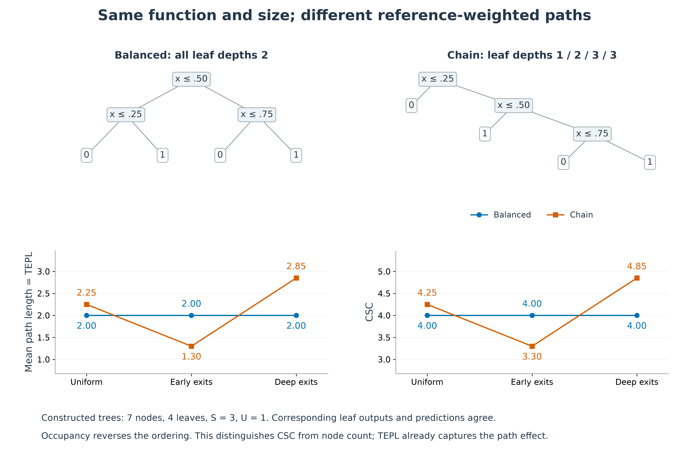
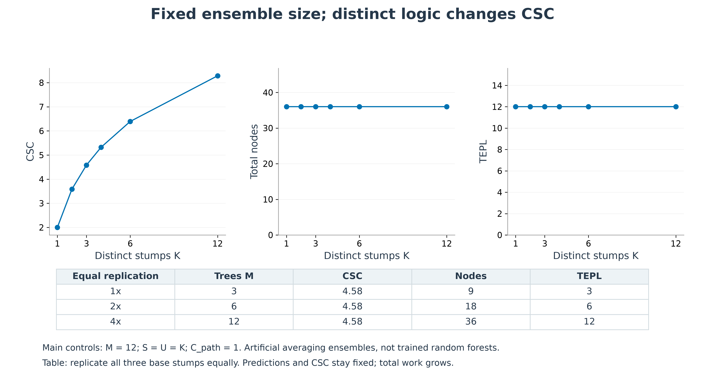
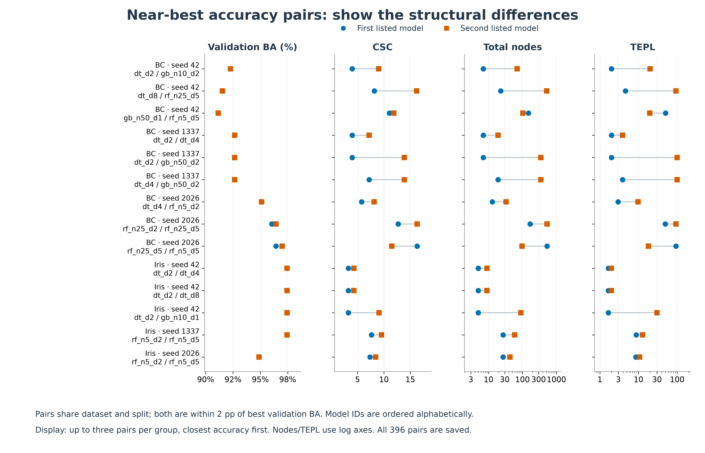
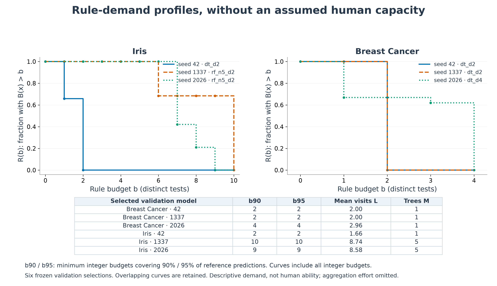

# Controlled comparisons: evidence report

CSC remains version 1.0. These studies test structural behavior, not human comprehension.

## Q1: fixed size and function

Both fixtures have 7 nodes, 4 leaves and 3 split tests, and agree in prediction. Balanced CSC is 4.00. Chain CSC is 4.25 (uniform), 3.30 (early exits), and 4.85 (deep exits). Node count misses the reversal; TEPL already captures it. This also demonstrates representation dependence.

## Q2: fixed ensemble size

With 12 stumps and 36 nodes, TEPL stays 12. CSC rises from 2.00 at K=1 to 8.29 at K=12. Equal replication of a three-stump averaging ensemble preserves predictions and CSC while nodes and visits grow. The diversity controls are artificial; their predictive functions are not held fixed.

## Q3: accuracy-matched validation pairs

396 unordered same-split pairs: 218 within 2 percentage points of one another; 116 also have both members within 2 percentage points of their group best.

| Baseline | Agree | Opposite ranking | Both tie | Baseline-only tie | CSC-only tie |
|---|---:|---:|---:|---:|---:|
| total_nodes | 112 | 3 | 1 | 0 | 0 |
| tepl | 108 | 7 | 1 | 0 | 0 |

These are descriptive totals of dependent pairs, not independent statistical samples. Per-dataset/seed counts are in q3_pair_summary.csv. CSC mostly agrees with baselines. Disagreement adds descriptive information but does not show which ranking is more useful to people. No near-best pair has an equal baseline value and different CSC in this grid.

## Rule-demand profiles

Reconstructed all 78 original rows; maximum numeric discrepancy 0. The original CSV and summary were preserved. Per-row B, L and M, exact exceedance curves, split IDs and dataset hashes are recorded. Demand quantiles are integer coverage budgets, not cognitive limits.

| Dataset / seed | Model | b90 | b95 | Mean visits L | Trees M |
|---|---|---:|---:|---:|---:|
| Iris / 42 | dt_d2 | 2 | 2 | 1.66 | 1 |
| Iris / 1337 | rf_n5_d2 | 10 | 10 | 8.74 | 5 |
| Iris / 2026 | rf_n5_d2 | 9 | 9 | 8.58 | 5 |
| Breast Cancer / 42 | dt_d2 | 2 | 2 | 2.00 | 1 |
| Breast Cancer / 1337 | dt_d2 | 2 | 2 | 2.00 | 1 |
| Breast Cancer / 2026 | dt_d4 | 4 | 4 | 2.96 | 1 |

The old 5/7/9-rule results remain available as hypothetical sensitivity scenarios. Neither CSC=7 nor R7>0.50 establishes an interpretability cutoff. Aggregation effort is not modeled.

## Scope and provenance

Constructed controls and exploratory matched comparisons concern different questions. The real datasets were already inspected during development. New measurements are not independent confirmation. The formula was not reweighted. See manifest.json, split_manifest.csv, dataset_hashes.json and protocols/controlled_v1.md for provenance.

## Figures

All figures also have vector PDF and SVG exports.
