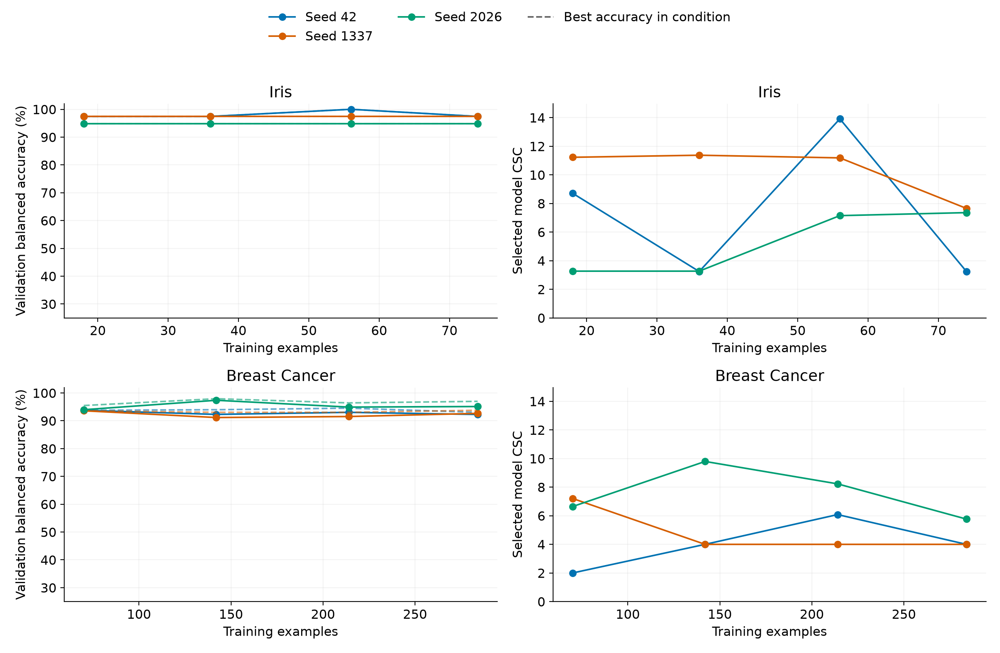
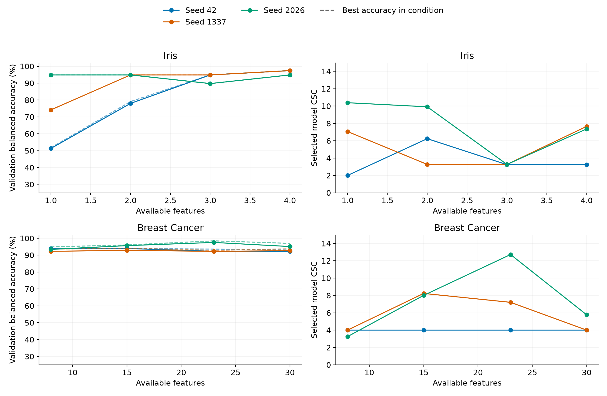
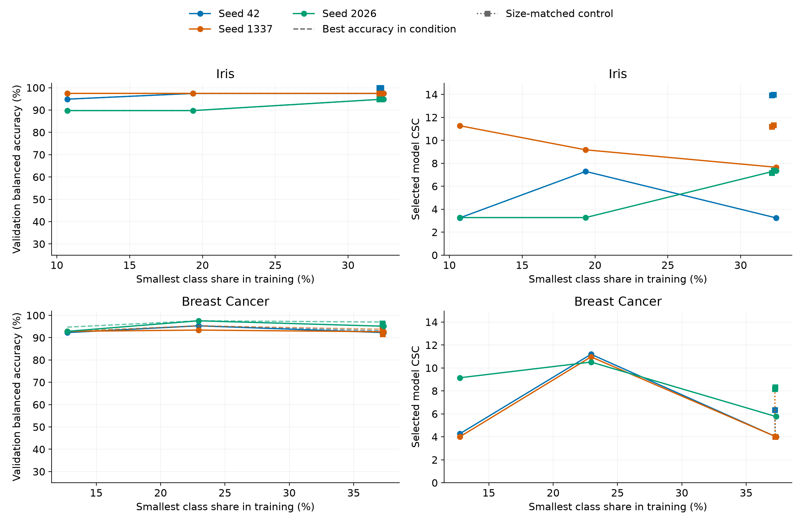
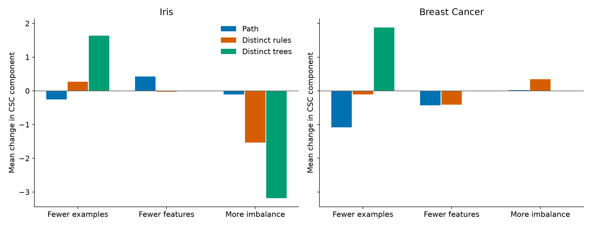

# Dataset meta-feature study

Completed 756 candidate fits across 63 distinct conditions, two datasets and three seeds. Shared inputs are reused across experiment aliases. The original 72 candidates reproduce their saved validation results, including R5/R7/R9. No additional test evaluations were performed.

## Reading the figures

Solid lines show the minimum-CSC model among candidates beating the dummy and within two percentage points of the condition's best balanced accuracy. Dashed lines show that best accuracy. Colors identify seeds. Dotted square lines are size-matched class-balance controls. Axes use actual counts or actual smallest-class share. Model IDs and changes are listed below and in selected_model_summary.csv. These plots describe model selection as well as training effects.

## Strongest intervention versus its reference

Sample and feature results compare 25% availability with the original condition. Balance results compare 25% retention of the designated class with a stratified control of the same total size. Differences below are intervention minus reference; accuracy changes are percentage points.

- breast_cancer / seed 42 / balance: accuracy +0.00 pp; CSC +0.27; dt_d2 to dt_d4; meets original accuracy reference: True.
- breast_cancer / seed 42 / features: accuracy +1.71 pp; CSC +0.00; dt_d2 to dt_d2; meets original accuracy reference: True.
- breast_cancer / seed 42 / samples: accuracy +1.51 pp; CSC -2.00; dt_d2 to dt_d1; meets original accuracy reference: True.
- breast_cancer / seed 1337 / balance: accuracy +1.30 pp; CSC +0.00; dt_d2 to dt_d2; meets original accuracy reference: True.
- breast_cancer / seed 1337 / features: accuracy -0.36 pp; CSC +0.00; dt_d2 to dt_d2; meets original accuracy reference: True.
- breast_cancer / seed 1337 / samples: accuracy +0.94 pp; CSC +3.21; dt_d2 to rf_n5_d2; meets original accuracy reference: True.
- breast_cancer / seed 2026 / balance: accuracy -3.21 pp; CSC +0.82; rf_n5_d2 to rf_n5_d5; meets original accuracy reference: False.
- breast_cancer / seed 2026 / features: accuracy -1.71 pp; CSC -2.51; dt_d4 to dt_d2; meets original accuracy reference: False.
- breast_cancer / seed 2026 / samples: accuracy -1.14 pp; CSC +0.88; dt_d4 to gb_n10_d1; meets original accuracy reference: False.
- iris / seed 42 / balance: accuracy -5.13 pp; CSC -10.67; gb_n50_d2 to dt_d2; meets original accuracy reference: False.
- iris / seed 42 / features: accuracy -46.15 pp; CSC -1.24; dt_d2 to dt_d1; meets original accuracy reference: False.
- iris / seed 42 / samples: accuracy +0.00 pp; CSC +5.47; dt_d2 to gb_n10_d1; meets original accuracy reference: True.
- iris / seed 1337 / balance: accuracy +0.00 pp; CSC +0.08; rf_n25_d2 to rf_n25_d2; meets original accuracy reference: True.
- iris / seed 1337 / features: accuracy -23.29 pp; CSC -0.60; rf_n5_d2 to dt_d4; meets original accuracy reference: False.
- iris / seed 1337 / samples: accuracy +0.00 pp; CSC +3.57; rf_n5_d2 to rf_n25_d2; meets original accuracy reference: True.
- iris / seed 2026 / balance: accuracy -5.13 pp; CSC -3.88; rf_n5_d2 to dt_d2; meets original accuracy reference: False.
- iris / seed 2026 / features: accuracy +0.00 pp; CSC +3.02; rf_n5_d2 to rf_n25_d2; meets original accuracy reference: True.
- iris / seed 2026 / samples: accuracy +0.00 pp; CSC -4.09; rf_n5_d2 to dt_d2; meets original accuracy reference: True.

## Fixed configurations and components

The fixed_* figures hold model ID constant and display every seed. fixed_configuration_summary.csv includes per-component changes relative to the same configuration on original data. imbalance_paired_comparisons.csv compares identical configurations with their size-matched controls. component_changes shows mean selected-model component changes; its means are descriptive summaries of three overlapping splits, not independent estimates.

- iris, samples: fixed configurations (36 paired configuration/seed rows), mean accuracy change -1.00 pp, mean CSC change -0.63; CSC fell in 27/36 rows. Selected CSC changes range -4.09 to +5.47; family changed in 2/3 seeds.
- breast_cancer, samples: fixed configurations (36 paired configuration/seed rows), mean accuracy change -0.66 pp, mean CSC change -1.93; CSC fell in 30/36 rows. Selected CSC changes range -2.00 to +3.21; family changed in 2/3 seeds.
- iris, features: fixed configurations (36 paired configuration/seed rows), mean accuracy change -24.20 pp, mean CSC change +0.42; CSC fell in 17/36 rows. Selected CSC changes range -1.24 to +3.02; family changed in 1/3 seeds.
- breast_cancer, features: fixed configurations (36 paired configuration/seed rows), mean accuracy change -1.17 pp, mean CSC change +0.04; CSC fell in 15/36 rows. Selected CSC changes range -2.51 to +0.00; family changed in 0/3 seeds.
- iris, balance: fixed configurations (36 paired configuration/seed rows), mean accuracy change -4.99 pp, mean CSC change -0.04; CSC fell in 14/36 rows. Selected CSC changes range -10.67 to +0.08; family changed in 2/3 seeds.
- breast_cancer, balance: fixed configurations (36 paired configuration/seed rows), mean accuracy change -3.59 pp, mean CSC change -0.93; CSC fell in 30/36 rows. Selected CSC changes range +0.00 to +0.82; family changed in 0/3 seeds.

## Performance and limitations

No eligible model: 0/63 conditions. No candidate reaches the original best accuracy minus two percentage points: 12/63 conditions.

Dataset properties affect the learned model, which then affects CSC. A smaller score can accompany a loss of useful information and accuracy. Feature removal changes feature content as well as count. Size matching limits the training-count confound but cannot hold individual examples identical. Seeds change data splits and random subsets together. With only two datasets and previously inspected validation data, these are exploratory within-dataset results, not universal causal laws or a fresh confirmation of interpretability. No human-effort unit or validated human threshold is claimed.
## Figures

### Same configuration across conditions

- [iris: samples, csc](figures/fixed_samples_iris_csc.png)
- [iris: samples, balanced_accuracy](figures/fixed_samples_iris_balanced_accuracy.png)
- [breast_cancer: samples, csc](figures/fixed_samples_breast_cancer_csc.png)
- [breast_cancer: samples, balanced_accuracy](figures/fixed_samples_breast_cancer_balanced_accuracy.png)
- [iris: features, csc](figures/fixed_features_iris_csc.png)
- [iris: features, balanced_accuracy](figures/fixed_features_iris_balanced_accuracy.png)
- [breast_cancer: features, csc](figures/fixed_features_breast_cancer_csc.png)
- [breast_cancer: features, balanced_accuracy](figures/fixed_features_breast_cancer_balanced_accuracy.png)
- [iris: balance, csc](figures/fixed_balance_iris_csc.png)
- [iris: balance, balanced_accuracy](figures/fixed_balance_iris_balanced_accuracy.png)
- [breast_cancer: balance, csc](figures/fixed_balance_breast_cancer_csc.png)
- [breast_cancer: balance, balanced_accuracy](figures/fixed_balance_breast_cancer_balanced_accuracy.png)

[Selected model IDs and changes](selected_model_changes.md)
