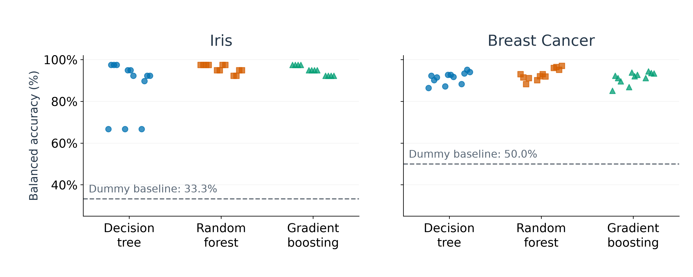
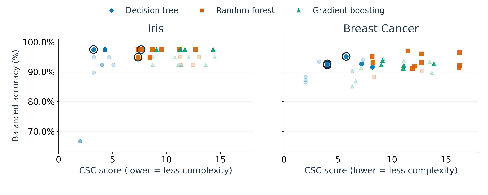
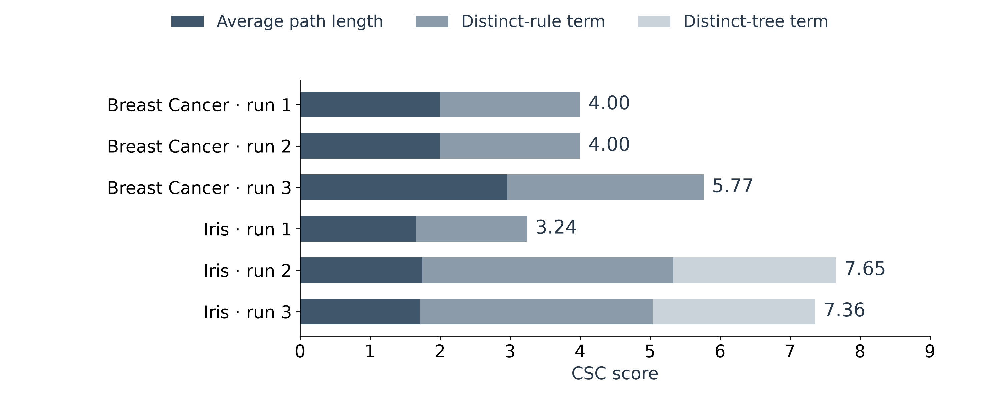
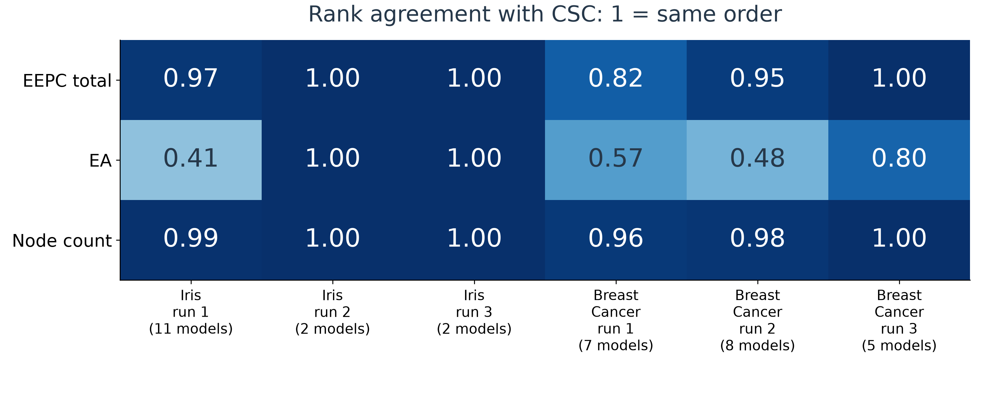

# CSC: metric development and real-data evaluation

## Definitions

EPL is the mean internal split count for one tree. EEPC_total sums tree EPL; EEPC_mean averages it. EA = EEPC_mean × log2(1 + features used); EA_total is a separate sensitivity. CSC = EEPC_mean + log2(1 + distinct splits) + log2(distinct full trees). These EA aggregation conventions were declared before this run. CSC is unchanged and MDL-inspired, not a formal code length.

## 1. Check predictive performance

All 72/72 candidates exceed the training-fitted dummy validation baseline. 35/72 also lie within two percentage points of their own dataset/seed best. These are competitive benchmark models, not a claim of application-level adequacy.

| Dataset | Seed | Dummy BA | Best BA | Competitive |
|---|---:|---:|---:|---:|
| Breast Cancer | 42 | 50.0% | 93.0% | 7/12 |
| Breast Cancer | 1337 | 50.0% | 93.8% | 8/12 |
| Breast Cancer | 2026 | 50.0% | 97.0% | 5/12 |
| Iris | 42 | 33.3% | 97.4% | 11/12 |
| Iris | 1337 | 33.3% | 97.4% | 2/12 |
| Iris | 2026 | 33.3% | 94.9% | 2/12 |

Every point is a validation candidate. Horizontal spread separates the three seeds; it is not a fitted trend. Balanced accuracy is mean recall across classes. Dummy predicts the most frequent training class.

## 2. Apply CSC among competitive models

Faint points fail the eligibility gate; solid points pass; rings mark minimum-CSC choices. Both datasets share axes. Each dataset/seed has its own best-accuracy reference.

| Dataset | Seed | Minimum CSC | Accuracy-only | Validation BA cost (pp) | CSC reduction |
|---|---:|---|---|---:|---:|
| Breast Cancer | 42 | dt_d2 | rf_n25_d2 | 0.76 | 8.74 |
| Breast Cancer | 1337 | dt_d2 | gb_n10_d2 | 1.12 | 5.13 |
| Breast Cancer | 2026 | dt_d4 | rf_n5_d5 | 1.87 | 5.72 |
| Iris | 42 | dt_d2 | dt_d2 | 0.00 | 0.00 |
| Iris | 1337 | rf_n5_d2 | rf_n5_d2 | 0.00 | 0.00 |
| Iris | 2026 | rf_n5_d2 | rf_n5_d2 | 0.00 | 0.00 |

Runs 1/2/3 correspond to seeds 42/1337/2026. Rule term = log2(1+S); tree term = log2(U). Equal component lengths are not calibrated equal human effort.

## 3. Compare with earlier measures

Spearman rank agreement is calculated separately within each dataset/seed among competitive candidates. A value of 1 means identical rank ordering; it does not establish that either measure is cognitively valid. Iris runs 2 and 3 contain only two competitive models, so perfect correlations there are weak evidence. The CSV also includes EEPC_mean and EA_total sensitivity. No independent-pair counts or significance claims are made.

## 4. Evaluate frozen choices on test data

| Dataset | Selector | Mean test BA | Sample SD (pp) | Mean test CSC |
|---|---|---:|---:|---:|
| Breast Cancer | accuracy_only | 94.39% | 2.00 | 11.12 |
| Breast Cancer | minimum_csc | 92.45% | 0.39 | 4.59 |
| Iris | accuracy_only | 96.44% | 3.09 | 6.10 |
| Iris | minimum_csc | 96.44% | 3.09 | 6.10 |

Choices were frozen on validation data, with no refit. Shared choices reuse the same test record. The three splits overlap: SD is descriptive, not a confidence interval. Test data were inspected in earlier work; this follow-up is not fresh confirmation. A validation tolerance does not guarantee a test-performance tolerance.

## Interpretation and limits

The evaluation tests predictive competitiveness and compares structural rankings. It does not measure human comprehension, prove superiority, or establish that MDL was numerically implemented. CSC's weights, logarithms and representation dependence remain assumptions. Original scores, formula and six original test choices were reconciled; see reconciliation.csv and manifest.json.

## Hypothetical budget appendix

Legacy R5/R7/R9 measurements are retained in candidates.csv. They describe distinct-test exceedance, not validated memory limits, and are not used in the primary selection or presentation.

## Sources

The two-part MDL explanation uses [Grünwald, A Tutorial Introduction to the Minimum Description Length Principle, sections 1.3–1.4](https://homepages.cwi.nl/~pdg/ftp/mdlintro.pdf). Tree path extraction is checked against [scikit-learn decision_path](https://scikit-learn.org/stable/modules/generated/sklearn.tree.DecisionTreeClassifier.html). EEPC, EA conventions and CSC are project definitions, not attributed to those sources.
